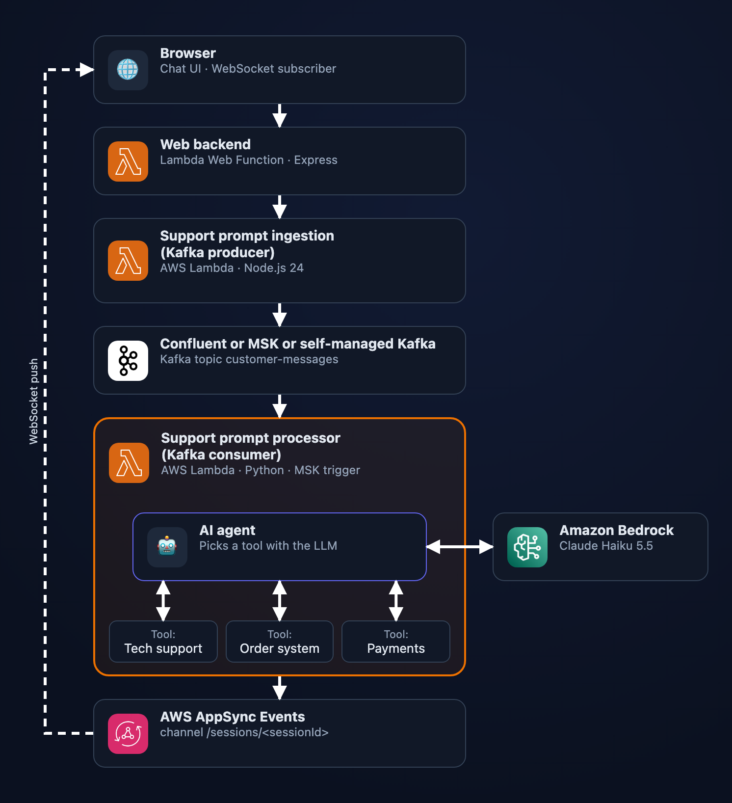

# Ambient serverless AI agent demo

A customer-support chat for a fictional electronics store, **VoltBay**, built on a serverless, event-driven architecture. Customer messages go into Kafka. A Lambda-hosted AI agent picks them up, uses Claude on Amazon Bedrock to decide which tool to use, and streams its progress and final answer back to the browser over WebSockets.

The webapp has two pages:

- **Store** (`/`): the storefront, with the support chat as a popup.
- **Under the hood** (`/technical`): the same chat next to a live architecture diagram that animates each message as it moves through the system.

## Architecture

<p align="center">
  
</p>

<sub>Captured from the app's <code>/technical</code> page, which animates this diagram for every chat message.</sub>

| Component | Tech | Code |
|---|---|---|
| Web backend and UI | Lambda Web Function, Node.js 24, Express 5 | [`webapp/`](webapp/) |
| Producer | Lambda, Node.js 24, kafkajs | [`producer/`](producer/) |
| Message stream | Amazon MSK (2 × `kafka.t3.small`, Kafka 3.9.x, private subnets) | [`terraform/kafka/`](terraform/kafka/) |
| Consumer and AI agent | Lambda, Python 3.15, MSK event source mapping | [`consumer/`](consumer/) |
| LLM | Claude Haiku 5.5 on Amazon Bedrock (`global.anthropic.claude-haiku-5-5`) | [`consumer/llm.py`](consumer/llm.py) |
| Push to browser | AWS AppSync Events, one channel per chat session (`/sessions/<sessionId>`) | [`terraform/appsync/`](terraform/appsync/) |
| Infrastructure | Terraform, `aws` and `awscc` providers | [`terraform/`](terraform/) |

### What the agent does

The consumer runs an agent for each message. The agent asks Claude to classify the message, then calls one of three tools:

| Request | Tool | Behavior |
|---|---|---|
| Technical problem ("My headphones are broken") | Tech support | Claude writes a short troubleshooting answer |
| Order status ("Track order 67890") | Order system | Claude extracts the order reference, then the tool returns a **made-up** arrival date, address and tracking number |
| Refund ("Refund order 12345") | Payments | Claude extracts the order reference, then the tool returns a **made-up** transaction ID |

The order and payment systems are simulated: they wait 3–5 seconds and generate random data. Nothing is stored, so asking about the same order twice gives different answers. The Claude calls are real.

### How the diagram knows what's happening

Every step in the diagram comes from the component doing the work. Nothing is simulated in the browser.

- **Steps 1–3** (browser → web backend → producer → Kafka) are streamed back on the `POST /api/messages` response as newline-delimited JSON.
- **Steps 4–11** (consumer → agent → Bedrock → tool → reply) are published by the consumer as `trace` events on the session's AppSync channel.
- **Step 12** is the reply itself arriving over the WebSocket.

The **Add delay** checkbox sends `delayMs: 1000` with the prompt. Each component pauses that long after every step, so you can follow the flow during a presentation. The default is 100 ms.

## Prerequisites

- An AWS account with **Amazon Bedrock access to Claude Haiku 5.5**
- An AWS CLI profile for that account. The Makefile uses `AWS_PROFILE=test1`; edit it to match yours.
- Terraform 1.9 or later
- Node.js and npm, to install the producer and webapp dependencies
- `nodemon`, only for running the webapp locally (`npm install -g nodemon`)

## Deploy

1. Set the login secrets:

   ```sh
   cp terraform/terraform.tfvars.example terraform/terraform.tfvars
   # edit: demo_key (what users type to sign in) and cookie_sign_key (32+ random characters)
   ```

   `terraform.tfvars` is gitignored. Both values are stored in AWS Secrets Manager.

2. Deploy:

   ```sh
   make deploy
   ```

   The first deploy takes about **20–30 minutes**, mostly creating the MSK cluster. The webapp URL is printed as the `webapp_url` output.

3. Open `webapp_url`, enter your demo key, and start chatting. The session cookie lasts 12 hours.

## Run the webapp locally

```sh
make watch
```

This runs the webapp on `http://localhost:3000` against the **deployed** backend (producer, Kafka, consumer, AppSync). The values it needs are written to `./tmp/` by `make deploy`, so deploy at least once first.

| You changed | To see it |
|---|---|
| `webapp/static/*` | Reload the browser |
| `webapp/*.js` | nodemon restarts the server; reload the browser |
| `producer/`, `consumer/`, `terraform/` | `make deploy` |

## Tear down

```sh
make destroy
```

[MSK costs about $69/month](https://aws.amazon.com/msk/pricing/) while it runs (2 × `kafka.t3.small`, us-east-1), plus the VPC endpoints for Lambda and STS. Destroy the stack when you're not demoing.

## Security notes

This is a demo, not production code:

- The whole webapp is behind a **shared demo key**. A correct key gets an HMAC-signed, `HttpOnly` session cookie valid for 12 hours. There's no per-user identity, logout or brute-force lockout beyond the endpoint's 10 requests/second limit.
- Kafka has **no authentication**. It's only reachable inside the private VPC.
- One allow-all security group is shared by everything in the VPC, which has no internet gateway or NAT.
- Browsers subscribe to AppSync with an API key. Only the consumer's IAM role can publish.
- The demo key and cookie signing key are stored in plaintext in the local Terraform state.

## Repository layout

```
webapp/       Lambda Web Function: Express server, login, static UI (store and technical pages)
producer/     Lambda that writes chat messages to Kafka
consumer/     Lambda that runs the agent: handler.py (consumer app), agent.py (agent and tools), llm.py (Bedrock)
terraform/    All infrastructure, one module per component
Makefile      build, deploy, destroy, watch
```
